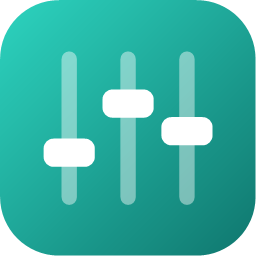
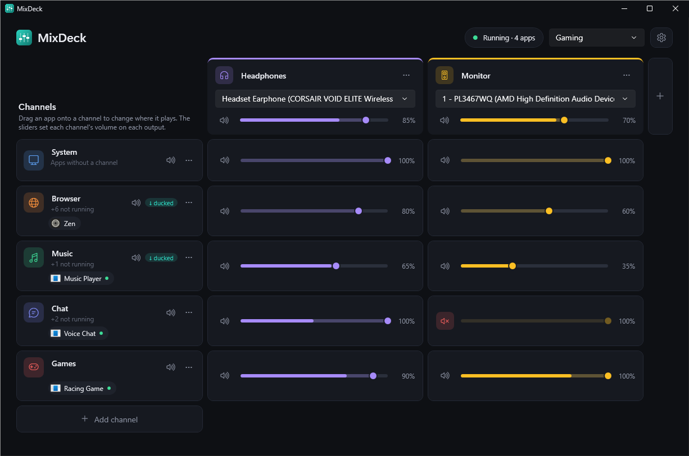
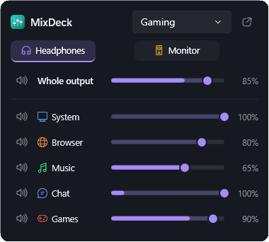
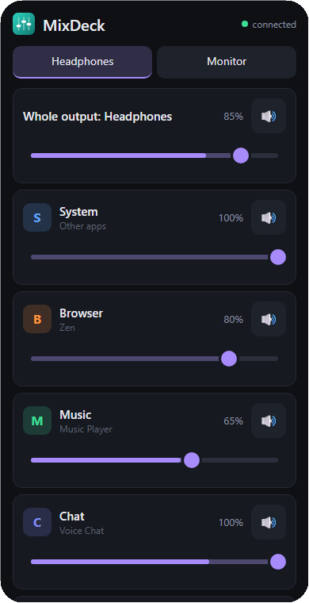
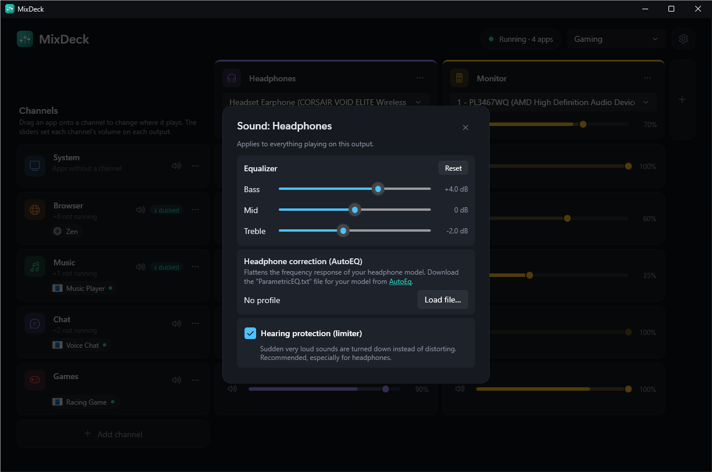
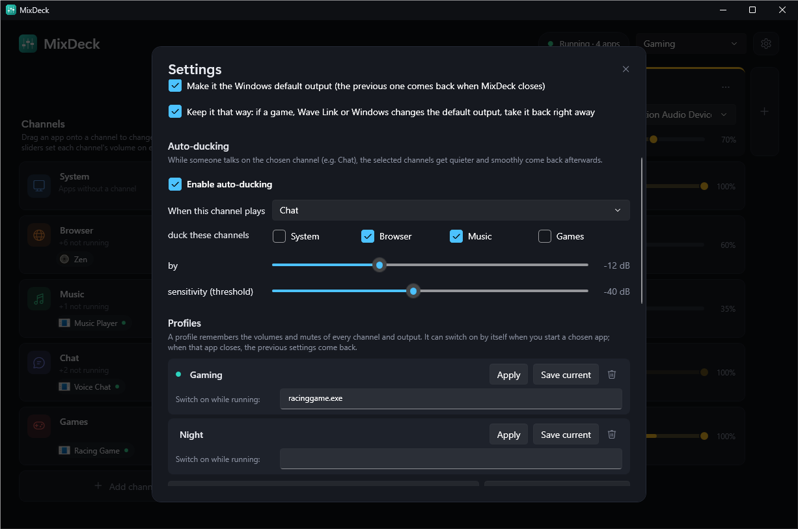
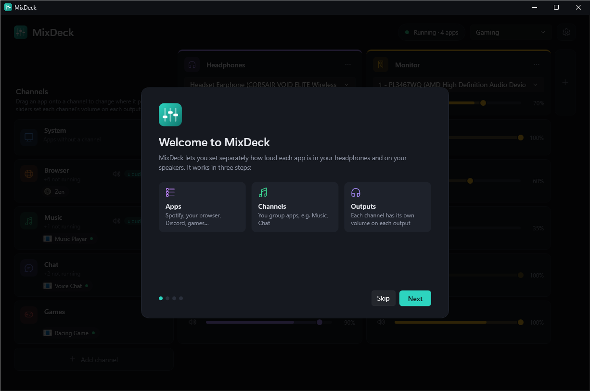

<p align="center"></p>

<h1 align="center">MixDeck</h1>

<p align="center">
  <b>Per-app audio mixer for Windows.</b><br>
  Every app in its own channel, every channel with its own volume on every output — headphones, speakers, a stream.<br>
  No virtual audio driver to install.
</p>

<p align="center">
  <a href="https://github.com/hpixsel/MixDeck/releases/latest"></a>
  <a href="LICENSE"></a>
  
  
</p>

<p align="center">
  <a href="https://github.com/hpixsel/MixDeck/releases/latest/download/MixDeck-win-Setup.exe"><b>⬇ Download MixDeck for Windows</b></a>
</p>

<p align="center"></p>

## Highlights

- **Channels × outputs.** Group apps into channels (Music, Chat, Games…) and set each channel's volume separately on each output: quieter music in the headphones, no chat on the speakers.
- **Drag and drop.** Apps appear as chips with their icons; drag one onto another channel to move it. Click a chip for that app's own volume.
- **Auto-ducking.** Music and the browser get quieter while someone talks on Chat, then smoothly come back.
- **Sound for every output.** EQ, AutoEQ headphone correction and a hearing-protection limiter per output; noise suppression (RNNoise), noise gate and compressor for microphones.
- **Stays out of the way.** Tray mini mixer, global hotkeys with an on-screen popup, profiles that switch on when a game starts, fallback devices when headphones are unplugged.
- **Control it from anywhere.** Phone remote via QR code, a local HTTP/WebSocket API, Home Assistant and Stream Deck examples.
- **Safe.** It restores your Windows default output on exit, and a watchdog does it even if MixDeck crashes. Updates install in one click.

## Screenshots

| Tray mini mixer | Phone remote |
|:---:|:---:|
|  |  |

| Output sound: EQ, AutoEQ, limiter | Settings: auto-ducking and profiles |
|:---:|:---:|
|  |  |

<p align="center"><br><sub>First-run setup wizard</sub></p>

## Install

Download **[MixDeck-win-Setup.exe](https://github.com/hpixsel/MixDeck/releases/latest/download/MixDeck-win-Setup.exe)** from the [latest release](https://github.com/hpixsel/MixDeck/releases/latest) and run it. It installs per user into `%LocalAppData%\MixDeck` without admin rights, adds a Start menu shortcut and installs .NET 10 if needed. On first start a setup wizard helps you pick your outputs and deal with conflicts such as Wave Link starting with Windows. New versions are offered inside the app (Settings → Updates).

## How it works

```
 apps ──▶ collector device (silent, e.g. Steam Streaming Speakers, set as the Windows default)
             │  each app captured separately (WASAPI process loopback)
             ▼
       channels: System, Browser, Music, Chat, microphones…
             │  per-output channel volume, ducking, effects
             ▼
       outputs: Headphones, Monitor, … ──▶ EQ, limiter ──▶ physical devices
```

- All apps play to a **collector device** that nobody listens to. MixDeck makes it the Windows default output, keeps it that way, and restores the previous default when it closes. If MixDeck crashes, a hidden watchdog process restores the audio anyway.
- Each app's audio goes to the channel you assign it to. Apps without an assignment go to **System**.
- Each output sums the channels with its own sliders and plays in the device's native format, including 8-channel "7.1" gaming headsets. When a device is unplugged, the output switches to a fallback device.

## Using it

| What | How |
|---|---|
| Assign an app | drag its chip onto another channel, or right-click it → "Move to…" |
| One app's volume within its channel | click its chip |
| Channel volume on an output | the slider in that output's column. The translucent fill is the setting, the solid bar the live signal. Mouse wheel: ±2%, double-click: 100% |
| Mute | the speaker in a channel row mutes it everywhere; the speaker in a cell only on that output |
| Mini mixer | click the tray icon (double-click opens the full window) |
| Rename | click a channel or output name |
| Output "⋯" menu | fallback devices, EQ, AutoEQ headphone correction, limiter |
| Channel "⋯" menu | microphone effects (RNNoise, rumble filter, gate, compressor), ducking |
| Settings (⚙) | autostart, collector device, ducking, profiles, hotkeys, phone remote, updates |

**Features:**
- **Profiles** remember all volumes and mutes. They can switch on automatically while a chosen game runs, and the previous settings come back when it closes.
- **Hotkeys** work system-wide, in games too, and show an on-screen popup: mute a channel or output, volume up/down, switch profile.
- **Auto-ducking:** while someone talks on Chat, Music and Browser get quieter (12 dB by default) and smoothly come back afterwards.
- **Microphones:** add a "Microphone or other input" channel. For Discord or OBS to hear the processed microphone, add an output on a virtual cable (e.g. VB-Cable) and select "CABLE Output" there.
- **Apps that bypass the mixer** (because they picked a specific device) show up in a yellow banner with a "Route through MixDeck" button.

## Phone remote, API and Home Assistant

Turn it on in **Settings → Phone remote and API** and scan the QR code with a phone on the same Wi-Fi. When Windows asks about the firewall, allow private networks. Every request needs the token from the address, as `?token=` or `Authorization: Bearer <token>`.

| Method | Path | Body (JSON, optional) |
|---|---|---|
| GET | `/api/state` | returns channels, outputs and profiles with their ids |
| POST | `/api/channels/{channel}/mute` | `{"muted": true}`, no body toggles |
| POST | `/api/channels/{channel}/sends/{output}` | `{"volume": 0-100, "muted": false}` |
| POST | `/api/mixes/{output}` | `{"volume": 0-100, "muted": false}` |
| POST | `/api/profiles/{profile}/apply` | — |
| WS | `/api/ws` | pushes `{"type":"state"}` on change and `{"type":"levels"}` about 15 times per second; accepts the commands `send`, `channel-mute`, `mix`, `profile` |

Get the ids from `GET /api/state`.

**Home Assistant** (`configuration.yaml`):

```yaml
rest_command:
  mixdeck_mute_music:
    url: "http://<pc-ip>:7317/api/channels/<music-channel-id>/mute?token=<token>"
    method: post
  mixdeck_profile:
    url: "http://<pc-ip>:7317/api/profiles/{{ profile }}/apply?token=<token>"
    method: post

automation:
  - alias: "Quiet speakers when the room light goes off"
    trigger:
      - platform: state
        entity_id: light.room
        to: "off"
    action:
      - service: rest_command.mixdeck_profile
        data:
          profile: "<night-profile-id>"
```

**Stream Deck:** any plugin that sends HTTP requests (e.g. "API Ninja"), with a URL from the table above.

## Requirements and limitations

- Windows 10 2004+ or Windows 11.
- A silent collector device: by default **Steam Streaming Speakers** (comes with Steam); the free VB-Cable works too.
- Close other mixers (Wave Link, Voicemeeter): they fight over the default device.
- Windows system sounds (the "System Sounds" session) don't go through the mixer.
- **Latency** from app to output is about 90 ms, or about 75 ms in low-latency mode (Settings → Advanced). Most of it is Windows' own capture. That's fine for music, video, games and calls, but not for monitoring your own voice live.

## Development

```powershell
dotnet build MixDeck.slnx
dotnet test tests\MixDeck.Tests          # DSP: filters, limiter, gate, clock-drift correction, AutoEQ, RNNoise
.\build\release.ps1                       # tests + installer and update packages in releases\
.\build\release.ps1 -Upload -RepoUrl https://github.com/<login>/MixDeck -Token <token>   # publish to GitHub Releases
.\build\make-icon.ps1                     # regenerates assets\MixDeck.ico and logo.png
```

**Updates:** installed copies check https://github.com/hpixsel/MixDeck releases (Settings → Updates; a folder with releases works too) and update themselves in one click.

**Command line:**
- `MixDeck.exe --minimized` starts in the tray,
- `MixDeck.exe --flyout` opens the mini mixer,
- `MixDeck.exe --quit` closes MixDeck and restores the default device.

Settings and the event log are in `%APPDATA%\MixDeck\`. With `MIXDECK_DEBUG=1` the log also shows buffer and capture levels.

| File | Role |
|---|---|
| `Audio/ProcessSource.cs` | captures one app (process loopback) |
| `Audio/DeviceSource.cs` | captures a microphone, converts to 48 kHz stereo, applies effects |
| `Audio/RingBuffer.cs`, `Audio/Dsp.cs` | lock-free buffer with smooth clock-drift correction; filters, gate, compressor, limiter, RNNoise |
| `Audio/MixBus.cs` | mix engine: channels → ducking → output → EQ and limiter → device format |
| `Audio/MixerService.cs` | finds apps and devices, assignments, fallback devices, guards the default device |
| `Remote/` | API (Kestrel), WebSocket, phone remote page |
| `Hotkeys.cs`, `Views/Osd.cs` | global hotkeys, on-screen popup |
| `Updater.cs`, `Program.cs` | updates (Velopack) |
| `ViewModels/`, `Views/`, `MainWindow.xaml` | UI (WPF, Fluent Dark theme, own palette) |

## License

[MIT](LICENSE) © 2026 Kacper Adamus. Third-party components keep their own licenses: NAudio (MIT), CommunityToolkit.Mvvm (MIT), QRCoder (MIT), Velopack (MIT), RNNoise (BSD-3-Clause).
